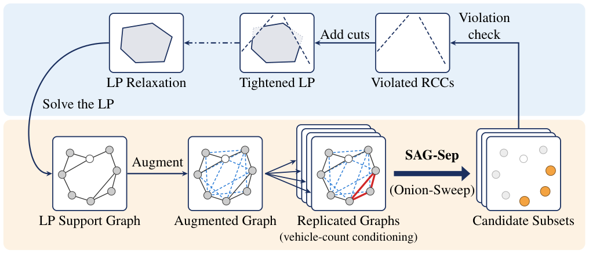

# SAG-Sep

Code and trained models for the NeurIPS 2026 paper

> **SAG-Sep: Sparse Augmented Graphs and Onion-Guided Search for Rounded Capacity Cut Separation**<br>
> Haoran Liu, Guanyi Wang, Yu Yang

SAG-Sep separates rounded capacity cuts (RCCs) for the capacitated vehicle
routing problem. In each round of the root cutting-plane loop it augments the
LP support graph with its two-hop closure, scores the customers with a graph
transformer on replicas conditioned on the vehicle count, and decodes the
scores into candidate customer sets with Onion-Sweep. Violated candidates are
added to the LP as cuts.

<p align="center"></p>

## Installation

Requires Gurobi (tested 13.0, with a license), ONNX Runtime (tested 1.23; the
GPU build is optional) and a C11 compiler. The Python reference implementation
uses Python 3.10.

```bash
conda create -n sagsep python=3.10 -y && conda activate sagsep
pip install -r package/python/requirements.txt

export GUROBI_HOME=/path/to/gurobi ONNXRUNTIME_HOME=/path/to/onnxruntime
make -C package/c -j8 all lib    # package/c/sagsep and package/c/libsagsep.a
```

## Usage

### Root relaxation

`sagsep` builds the two-index root LP of an instance and runs the cutting-plane
loop until the separator finds no further violated cut:

```bash
cd package/c
SAGSEP_INSTANCES_ROOT=../../instances/random ./sagsep --size-preset n100 \
    --instance random-2-X-n100 --onnx ../../models/cvrp-two-index-best.onnx \
    --device cpu --out results/
```

The result file `results/root_relax_<instance>_learned_fb.json` holds the root
bound (`lower_bound`), the number of rounds and whether the time limit was hit.
The Python reference implementation takes the same flags:
`SAGSEP_RUN_DIR=../../models/cvrp-two-index-best.ckpt python -m sagsep ...`,
run from `package/python`.

### Separator API

To call SAG-Sep from your own solver, link `package/c/libsagsep.a` and include
`package/c/include/sep_api.h`. You solve the LP, the separator proposes cuts for
the current solution, and you report which of them you added.

```c
#include "sep_api.h"

sag_separator_options opt = {0};
opt.model_path    = "models/cvrp-two-index-best.onnx";
opt.provider      = "cpu";             /* or "cuda", "cuda:0" */
opt.instance_name = "X-n101-k25";      /* seeds the random stream */
opt.preset        = "n100";            /* size preset, or a .toml path */
opt.n_nodes       = n;                 /* depot 0, customers 1..n-1 */
opt.capacity      = Q;
opt.demand        = demand;            /* length n, demand[0] = 0 */
sag_separator *sep = sag_separator_create(&opt);

/* once per round, on the m support edges (u[e], v[e]) with LP values x[e] */
sag_separator_cuts cuts;
sag_separator_stats stats;
int64_t rows = sag_separator_separate(sep, m, u, v, x, &cuts, &stats);

int64_t accepted[MAX_ROWS], n_accepted = 0;
for (int64_t r = 0; r < rows; ++r) {
    /* S = cuts.customers[cuts.indptr[r] .. cuts.indptr[r+1])
       cut: x(delta(S)) >= 2 * cuts.rhs[r]   or   x(E(S)) <= |S| - cuts.rhs[r] */
    if (add_cut_to_my_lp(&cuts, r)) accepted[n_accepted++] = r;
}
sag_separator_commit(sep, accepted, n_accepted);

sag_separator_destroy(sep);
```

- Call `sag_separator_commit` exactly once after every separate call, also when
  you added nothing.
- Keep the rows with `cuts.violation[r] > stats.min_violation`, as the root loop
  does.
- When you delete cuts from your LP, pass the cuts it still holds to
  `sag_separator_set_blocked`.
- `models/cvrp-spf-best.onnx`, the model fine-tuned for branch-price-and-cut,
  needs `opt.cross_depot = SAG_CROSS_DEPOT_DISABLED`.

## Root bounds against CVRPSEP

The released C engine (default recipe) and CVRPSEP, both run to closure in the
same root loop with tail-off stopping disabled. Means over the ten
`instances/random` instances per size; the gap is to the optimal value, and the
time ratio uses unrounded means.

| N | CVRPSEP gap (%) | SAG-Sep gap (%) | CVRPSEP s/inst (CPU) | SAG-Sep s/inst (GPU) | time ratio |
|---|---:|---:|---:|---:|---:|
| 50  | 1.969 | 1.968 | 0.09 | 0.16 | 1.86x |
| 75  | 2.768 | 2.768 | 0.63 | 0.74 | 1.19x |
| 100 | 4.539 | 4.538 | 2.93 | 2.20 | 0.75x |
| 200 | 6.281 | 6.283 | 95.8 | 32.1 | 0.34x |

The two time columns use different devices, so they compare systems rather than
separators. On one CPU core SAG-Sep takes 0.50, 6.9 and 67 s per instance at
N = 50, 100 and 200.

## Reproducing the paper

The NeurIPS paper is about **Onion-Sweep**: a max-violation sweep per replica
plus the onion across replicas. `--recipe os` runs exactly that. The paper uses
the ten `instances/random` instances of each size, `--vehicles` and `--optimal`
from `instances/random/manifest.csv`, the preset's 3600 s limit and the forward
pass on the GPU:

```bash
cd package/c
SAGSEP_INSTANCES_ROOT=../../instances/random ./sagsep --size-preset n100 --recipe os \
    --instance random-2-X-n100 --vehicles 11 --optimal 17242 \
    --onnx ../../models/cvrp-two-index-best.onnx --device cuda:0 --out results/os/
```

Expect close but not identical numbers. The paper was run with our research
code, which, following NeuralSEP, kept a set proposed twice in one round as two
LP rows; this package drops the duplicate, which can lead the simplex to a
different optimal vertex. Per-instance gaps can move by up to about half a
point, while size means stay close. `--device cpu` is reproducible from run to
run; `--device cuda` is not.
`instances/xml` (the large XML instances) and `instances/X` (the CVRPLIB X set)
run the same way with a matching preset and `--vehicles` from their
`manifest.csv`.

The default recipe, `--recipe full`, adds a test-time cut-refinement layer (TTS) after
Onion-Sweep. TTS belongs to the extended version of this work, which will be
submitted to a journal, and is not part of the NeurIPS contribution. It is
released here because the preliminary branch-and-cut and
branch-price-and-cut results that answered reviewer questions in the NeurIPS
rebuttal use it. Their drivers are in `examples/bc` (CVRP, VRPTW, ACVRP, OVRP,
CMST) and `examples/bpc` (RouteOpt, CVRP and VRPTW).

The exact-label set the released checkpoint was trained on, computed on the
CVRPLIB XML100 instances and stored in the shard format of `sagsep_train`, is
archived at https://doi.org/10.5281/zenodo.23539579. To retrain the checkpoint
on it:

```bash
pip install -r package/python/requirements-train.txt
cd package/python
python -m sagsep_train train --config ../../configs/train/cvrp-two-index-best.toml \
    --out runs/ref --set data.dataset_dir=/path/to/the/download
```

The recipe was run on one B200 GPU; on smaller GPUs, lower `data.batch_size`.

## License

MIT, see [LICENSE](LICENSE). The exception is `examples/bpc/RouteOpt`, which is
RouteOpt (GPL-3.0) at upstream commit `950b9a3`, modified by us in 2026 with the
patches in `examples/bpc/patches`. Other vendored code and data keep their own
license files.
